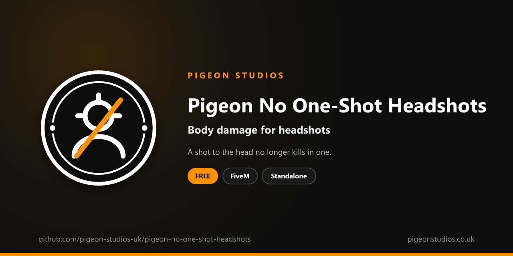

<div align="center">
  

  <h1>Pigeon No One-Shot Headshots</h1>

  <p><strong>Stops headshots killing players in one shot, so a shot to the head does the same damage as one to the body.</strong></p>

  <p>
    <a href="https://github.com/pigeon-studios-uk/pigeon-no-one-shot-headshots/releases/latest"></a>
    <a href="LICENSE.md"></a>
    <a href="https://discord.gg/2NFVWEUmDF"></a>
    
  </p>

  <p>
    <a href="https://github.com/pigeon-studios-uk/pigeon-no-one-shot-headshots/releases/latest"><strong>Download</strong></a> ·
    <a href="#installation">Install</a> ·
    <a href="#configuration">Configure</a> ·
    <a href="CHANGELOG.md">Changelog</a> ·
    <a href="https://discord.gg/2NFVWEUmDF">Support</a>
  </p>
</div>

---

## Contents

- [Overview](#overview)
- [Features](#features)
- [Requirements](#requirements)
- [Installation](#installation)
- [Updating](#updating)
- [Configuration](#configuration)
- [Commands and exports](#commands-and-exports)
- [How it works](#how-it-works)
- [Update checker](#update-checker)
- [Performance](#performance)
- [Security](#security)
- [Troubleshooting](#troubleshooting)
- [FAQ](#faq)
- [Support](#support)
- [Contributing](#contributing)
- [Licence](#licence)
- [Credits](#credits)

## Overview

Pigeon No One-Shot Headshots is a free resource by [Pigeon Studios](https://pigeonstudios.co.uk) that takes away GTA's one-shot headshots. In GTA, a shot to the head does many times the damage of a shot to the body, so most guns kill in a single headshot. On roleplay servers that ends scenes in a moment, and makes aim assist and modified games far more dangerous than they should be.

With this resource, a headshot does the same damage as a shot to the body. Gunfights last long enough for roleplay, and armour and health matter again.

## Features

- **No one-shot headshots.** A shot to the head does body damage, with every gun.
- **Every player.** Applied to each player's own character, so it covers everyone on the server.
- **Survives respawns and model changes.** Applied again straight away when a player respawns, and every second in case their character changes some other way.
- **Export.** Give one player GTA's full headshot damage again, for example inside an arena or a hardcore zone.
- **Undoes itself.** Stopping the resource gives headshots their extra damage back.
- **Standalone.** No framework or other resources needed.

## Requirements

| Requirement | Version | Notes |
|---|---|---|
| FXServer | A [recommended artifact](https://runtime.fivem.net/artifacts/) | |

**Frameworks:** none needed. It works the same on standalone servers, ESX Legacy, QBCore, Qbox and ox_core.

## Installation

1. **Download** `pigeon-no-one-shot-headshots.zip` from the [latest release](https://github.com/pigeon-studios-uk/pigeon-no-one-shot-headshots/releases/latest). Don't use the green **Code** button; release zips are the tested builds.
2. **Extract** it into your server's `resources` folder. The folder must be called `pigeon-no-one-shot-headshots`.
3. **Start it** by adding this to `server.cfg`:

   ```cfg
   ensure pigeon-no-one-shot-headshots
   ```

4. **Configure** it in `configuration/config.lua` if you want to change anything. The defaults work as they are.
5. **Restart** your server. The console shows one line from the update checker:

   ```text
   [Pigeon Studios] Pigeon No One-Shot Headshots v1.0.0 is up to date.
   ```

## Updating

1. Read the [changelog](CHANGELOG.md) for every version between yours and the latest, especially any **Upgrade notes**.
2. Back up your `configuration/` folder.
3. Replace the `pigeon-no-one-shot-headshots` folder with the new release.
4. Copy your changed settings into the new `configuration/config.lua`. Don't copy the old file over the new one; new versions can add settings.
5. Restart the resource.

## Configuration

All settings are in `configuration/config.lua`, each explained by a comment next to it.

| Setting | Default | What it does |
|---|---|---|
| `Config.CriticalHeadshots` | `false` | `false`: headshots do body damage. `true`: GTA's normal headshots, for using the export only |
| `Config.ReapplySeconds` | `1.0` | How often the setting is applied again, for characters that change without a respawn |

## Commands and exports

Client exports, for other resources:

```lua
-- Give this player GTA's full headshot damage, such as on entering an arena.
exports['pigeon-no-one-shot-headshots']:SetHeadshots(true)

-- Back to the config.
exports['pigeon-no-one-shot-headshots']:SetHeadshots(nil)

-- true if this player currently takes full headshot damage.
local full = exports['pigeon-no-one-shot-headshots']:HasHeadshots()
```

The export runs in the player's own game, so call it from a client script for the player it should apply to.

## How it works

GTA calls a shot to the head a "critical hit", and multiplies its damage. Whether a character takes that extra damage is a per-character setting. The resource turns it off for each player's own character with `SetPedSuffersCriticalHits`, so a headshot does the same damage as a shot to the body. Weapon damage isn't otherwise changed.

A character's settings reset when the character is replaced, which happens when a player respawns, changes model or has their appearance reset by some clothing resources. The setting is applied again straight away on respawn, and every `Config.ReapplySeconds` for anything else. When the resource stops, headshots do their full damage again.

## Update checker

When it starts, Pigeon No One-Shot Headshots checks our public [version registry](https://github.com/pigeon-studios-uk/pigeon-versions) once and prints one line in the server console saying whether it's up to date. If there's an update, it shows what's new and where to get it. The check is a single request to GitHub and sends nothing about your server or players.

Control it for every Pigeon Studios resource at once in `server.cfg`:

```cfg
set pigeon_update_check "on"      # default: one line per resource
set pigeon_update_check "quiet"   # only when there's an update or a problem
set pigeon_update_check "off"     # never check
```

## Performance

It sets one setting once a second and does nothing else. Nothing runs every frame, and nothing runs on the server apart from the update check at start-up.

## Security

- It runs only in each player's own game and only changes that player's own character. Other players and NPCs are never touched.
- It has two client exports for other resources on your server, and no commands or network events, so there is nothing other players or the server can send it.
- The only network request is the update check at start-up, from the server to GitHub. It sends nothing about your server or players.
- Like every setting in the player's game, a player with a modified game could get around it, but only to make headshots hurt themselves more. It isn't an anti-cheat.

Found a problem? Please don't open a public issue. Use the **Report a vulnerability** button in this repository's **Security** tab, or follow our [Security Policy](https://github.com/pigeon-studios-uk/.github/blob/main/SECURITY.md).

## Troubleshooting

**Headshots still kill in one shot.**
Check the resource is started and there are no errors in the F8 console. A weapon whose body damage is already enough to kill, such as a heavy sniper, still kills in one shot anywhere. Resources that change weapon damage themselves aren't affected.

**Helmets still stop headshots.**
That's GTA's hidden helmet armour, a separate setting. See [Pigeon No Helmet Armour](https://github.com/pigeon-studios-uk/pigeon-no-helmet-armour).

**The console says "isn't in the version registry" or "couldn't check for updates".**
Your server couldn't reach GitHub, or the check is blocked by a firewall. The resource works normally either way. Turn the check off with `set pigeon_update_check "off"`.

## FAQ

**Is it really free?**
Yes. Use it on as many servers as you like, including ones that take donations. You just can't reupload, resell or bundle it. See [Licence](#licence).

**Does it affect NPCs?**
No. Only players' own characters are changed, so players can still drop NPCs with a headshot.

**Does it make players harder to kill overall?**
Only by headshots. Shots to the body, and armour, work exactly as before.

**Can I set it per weapon?**
No. GTA's setting is per character, not per weapon. For different damage by weapon, use a weapon damage resource.

## Support

Read [Troubleshooting](#troubleshooting) first, then ask in the support channels of our [Discord](https://discord.gg/2NFVWEUmDF). Please include your Pigeon No One-Shot Headshots version, FXServer artifact and any errors from the console. See [Getting help](https://github.com/pigeon-studios-uk/.github/blob/main/SUPPORT.md).

Found a bug? Open a [bug report](https://github.com/pigeon-studios-uk/pigeon-no-one-shot-headshots/issues/new/choose).

## Contributing

Fixes, improvements and translations are welcome. Please read the [contributing guide](https://github.com/pigeon-studios-uk/.github/blob/main/CONTRIBUTING.md) first, and open a feature request before working on anything big.

## Licence

Pigeon No One-Shot Headshots is free to use under the **[Pigeon Studios Free Licence](LICENSE.md)**.

- ✅ Use it on any number of servers, including monetised ones
- ✅ Change it for your own servers
- ✅ Show it in videos and streams
- ❌ Don't reupload, share or mirror the files; link to this repository instead
- ❌ Don't sell it, bundle it in packs, or put it behind escrow
- ❌ Don't remove the credits

This summary isn't the licence; [LICENSE.md](LICENSE.md) is. Third-party notices are in [NOTICE.md](NOTICE.md).

## Credits

Made by [Pigeon Studios](https://pigeonstudios.co.uk).

<sub>Not affiliated with or endorsed by Rockstar Games, Take-Two Interactive or Cfx.re.</sub>
